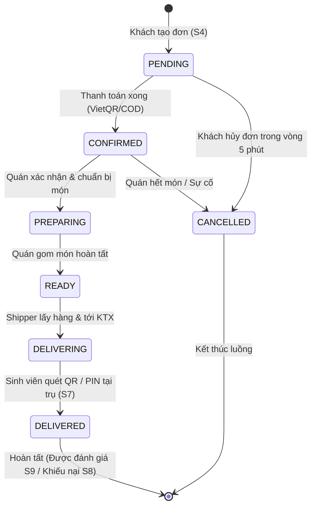

# TÀI LIỆU KIẾN TRÚC HỆ THỐNG (ARCHITECTURE DOCUMENTATION)

- **Dự án:** Food Ordering App (PRM393 - Lab 3)
- **Kiến trúc áp dụng:** Clean Layered Architecture (Kiến trúc phân tầng kết hợp Repository Abstraction)
- **Mục tiêu then chốt:** "MySQL Now, Firebase Later" – Tách rời tuyệt đối tầng Nghiệp vụ (Business Layer) khỏi tầng Dữ liệu vật lý (Data Access Layer).

---

## 1. Nguyên tắc Thiết kế Kiến trúc (Architectural Principles)

```mermaid
flowchart TD
    Client["Flutter Mobile Client (MVVM)"]
    
    subgraph Presentation_Layer ["Tầng Trình Diễn (Presentation Layer)"]
        Controller["REST Controllers (@RestController)<br/>- Xác thực định dạng Request (@Valid)<br/>- Điều hướng tới Service<br/>- Đóng gói DTO thành ApiResponse"]
    end

    subgraph Business_Layer ["Tầng Nghiệp Vụ (Business Logic Layer)"]
        Service["Application Services (@Service)<br/>- Thực thi Business Rules & State Machine<br/>- Không import Hibernate/JPA SDK<br/>- Không import Firebase SDK<br/>- Chỉ thao tác với Domain Model & DTO"]
    end

    subgraph Domain_Abstraction ["Tầng Trừu Tượng Dữ Liệu (Domain Repository Abstraction)"]
        RepoInterface["Repository Interfaces (Pure Java)<br/>- OrderRepository<br/>- StoreRepository<br/>- DisputeRepository, etc."]
    end

    subgraph Data_Layer_MySQL ["Tầng Truy Cập Dữ Liệu MySQL (Hiện Tại)"]
        MySQLRepo["MySqlRepository Impl (@Repository)<br/>- Bọc Spring Data JpaRepository<br/>- Entity JPA (Hibernate)<br/>- MySQL 8.x Database"]
    end

    subgraph Data_Layer_Firestore ["Tầng Truy Cập Dữ Liệu Firestore (Tương Lai)"]
        FirestoreRepo["FirestoreRepository Impl (@Repository)<br/>- Firebase Firestore SDK<br/>- Firestore Documents & Collections"]
    end

    Client -->|HTTP / JSON (RESTful)| Controller
    Controller -->|DTO Request / Response| Service
    Service -->|Chỉ phụ thuộc Interface| RepoInterface
    RepoInterface -.->|Triển khai hiện tại| MySQLRepo
    RepoInterface -.->|Thay thế tương lai| FirestoreRepo
```

### Các Ràng buộc Kiến trúc Tuyệt đối (Strict Boundaries):
1. **Controller:** Chỉ tiếp nhận HTTP request, kích hoạt validation tầng format (`@Valid`), gọi phương thức Service tương ứng và trả về `ResponseEntity<ApiResponse<T>>`. Tuyệt đối không gọi trực tiếp Repository và không xử lý business logic tại Controller.
2. **Service:** Là nơi duy nhất chứa Business Rules, tính toán tiền bạc, kiểm tra chuyển đổi trạng thái (State Machine). Service chỉ tương tác với Repository Interface thuần Java (`org.example.order_app_backend.repository`). Không bao giờ import `org.springframework.data.jpa.repository.JpaRepository`, `jakarta.persistence.EntityManager`, hay `com.google.cloud.firestore.Firestore`.
3. **Entity:** Thuộc tầng Persistence. Không bao giờ trả JPA Entity trực tiếp ra Controller/API. Mọi dữ liệu ra vào API đều thông qua DTO và được chuyển đổi bởi Mapper.
4. **Security / Current User:** Service không phụ thuộc vào `SecurityContextHolder` hay Firebase Auth SDK một cách trực tiếp mà thông qua interface `CurrentUserProvider`.

---

## 2. Cấu trúc Gói Mã nguồn (Package Structure)

```text
org.example.order_app_backend
├── config                      # Cấu hình OpenAPI/Swagger, Cors, Bean Lifecycle
│   ├── OpenApiConfig.java
│   └── WebMvcConfig.java
├── controller                  # Tầng REST API Endpoints
│   ├── AuthController.java
│   ├── StoreController.java
│   ├── MenuItemController.java
│   ├── OrderController.java
│   ├── PaymentController.java
│   ├── DisputeController.java
│   ├── ReviewController.java
│   └── NotificationController.java
├── service                     # Business Logic Layer (Interfaces & Impl)
│   ├── AuthService.java
│   ├── StoreService.java
│   ├── MenuItemService.java
│   ├── OrderService.java
│   ├── PaymentService.java
│   ├── DisputeService.java
│   ├── ReviewService.java
│   ├── NotificationService.java
│   └── impl/
│       ├── AuthServiceImpl.java
│       ├── StoreServiceImpl.java
│       ├── MenuItemServiceImpl.java
│       ├── OrderServiceImpl.java
│       ├── PaymentServiceImpl.java
│       ├── DisputeServiceImpl.java
│       ├── ReviewServiceImpl.java
│       └── NotificationServiceImpl.java
├── repository                  # Repository Abstraction (Pure Java Interfaces)
│   ├── UserRepository.java
│   ├── StoreRepository.java
│   ├── MenuItemRepository.java
│   ├── OrderRepository.java
│   ├── PaymentRepository.java
│   ├── DisputeRepository.java
│   ├── ReviewRepository.java
│   ├── NotificationRepository.java
│   └── mysql/                  # MySQL / JPA Implementations (Hiện tại)
│       ├── jpa/                # Spring Data JpaRepository Interfaces
│       │   ├── UserJpaRepository.java
│       │   ├── StoreJpaRepository.java
│       │   ├── MenuItemJpaRepository.java
│       │   ├── OrderJpaRepository.java
│       │   └── ...
│       ├── MySqlUserRepository.java
│       ├── MySqlStoreRepository.java
│       ├── MySqlOrderRepository.java
│       └── ...
├── entity                      # JPA Entities (MySQL Table Mapping)
│   ├── BaseEntity.java         # id, createdAt, updatedAt
│   ├── UserEntity.java
│   ├── StoreEntity.java
│   ├── MenuItemEntity.java
│   ├── OrderEntity.java
│   ├── OrderItemEntity.java
│   ├── PaymentEntity.java
│   ├── DisputeEntity.java
│   ├── ReviewEntity.java
│   └── NotificationEntity.java
├── dto                         # Data Transfer Objects
│   ├── common/
│   │   ├── ApiResponse.java
│   │   ├── ApiErrorResponse.java
│   │   └── PageResponse.java
│   ├── request/
│   │   ├── CreateOrderRequest.java
│   │   ├── OrderItemRequest.java
│   │   ├── CreateDisputeRequest.java
│   │   ├── CreateReviewRequest.java
│   │   └── ...
│   └── response/
│       ├── StoreResponse.java
│       ├── MenuItemResponse.java
│       ├── OrderResponse.java
│       ├── OrderItemResponse.java
│       ├── DisputeResponse.java
│       ├── ReviewResponse.java
│       └── ...
├── mapper                      # Chuyển đổi DTO <--> Entity (Tách biệt logic)
│   ├── StoreMapper.java
│   ├── MenuItemMapper.java
│   ├── OrderMapper.java
│   ├── DisputeMapper.java
│   └── ...
├── exception                   # Bắt lỗi toàn cục & Mã lỗi thống nhất
│   ├── AppException.java
│   ├── ErrorCode.java
│   ├── GlobalExceptionHandler.java
│   ├── ResourceNotFoundException.java
│   └── BusinessRuleException.java
└── security                    # Phân quyền & Định danh người dùng
    ├── CurrentUserProvider.java
    ├── SecurityConfig.java
    └── SecurityContextUserProvider.java
```

---

## 3. Chiến lược Tách rời Dữ liệu (Decoupling Strategy: MySQL vs Firestore)

### 3.1. Repository Pattern
Khi `OrderService` cần lấy thông tin đơn hàng hoặc lưu đơn mới:
```java
public interface OrderRepository {
    OrderEntity save(OrderEntity order);
    Optional<OrderEntity> findById(Long id);
    List<OrderEntity> findByUserId(Long userId);
    List<OrderEntity> findByStoreIdAndSlotTime(Long storeId, String slotTime);
}
```

Ở trạng thái **MySQL hiện tại**:
```java
@Repository
@Primary
public class MySqlOrderRepository implements OrderRepository {
    private final OrderJpaRepository jpaRepository;
    
    public MySqlOrderRepository(OrderJpaRepository jpaRepository) {
        this.jpaRepository = jpaRepository;
    }
    
    @Override
    public OrderEntity save(OrderEntity order) {
        return jpaRepository.save(order);
    }
    // ...
}
```

Trong tương lai khi **chuyển sang Firestore**:
- Tạo `FirestoreOrderRepository implements OrderRepository`.
- Thay đổi cấu hình Spring Profile (`@Profile("firestore")`) hoặc `@Primary`.
- Toàn bộ 100% mã nguồn trong `OrderService` được tái sử dụng nguyên vẹn.

---

## 4. Mô hình Trạng thái Đơn hàng (Order State Machine)

Để ngăn ngừa hành vi sai luồng (ví dụ: chuyển từ `DELIVERED` ngược lại `PREPARING`, hoặc hủy đơn khi đã giao):



---

## 5. Chiến lược Xử lý Ngoại lệ (Global Exception Handling)
Toàn bộ Exception trong hệ thống được chặn và dịch sang chuẩn `ApiErrorResponse`:
1. `MethodArgumentNotValidException` $\rightarrow$ Trả về mã lỗi `VALIDATION_FAILED` (HTTP 400) kèm danh sách trường vi phạm.
2. `ResourceNotFoundException` $\rightarrow$ Trả về mã lỗi `NOT_FOUND` (HTTP 404).
3. `BusinessRuleException` $\rightarrow$ Trả về các mã nghiệp vụ như `ORDER_EMPTY`, `INVALID_STATUS_TRANSITION`, `DISPUTE_EVIDENCE_REQUIRED` (HTTP 400 / 422).
4. `AccessDeniedException` $\rightarrow$ Trả về mã `FORBIDDEN` (HTTP 403).
5. `Exception` (Unhandled) $\rightarrow$ Trả về mã `INTERNAL_SERVER_ERROR` (HTTP 500) và ẩn thông tin nhạy cảm.
