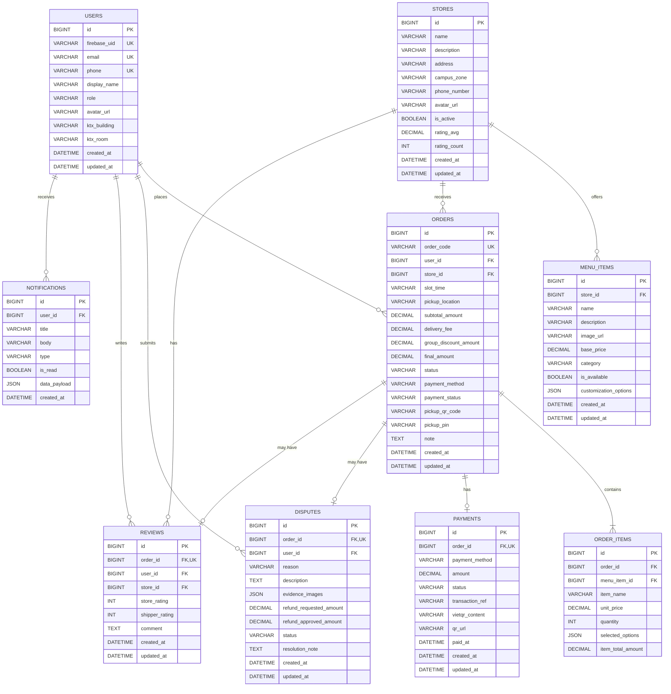

# THIẾT KẾ CƠ SỞ DỮ LIỆU MYSQL (DATABASE SCHEMA SPECIFICATION)

- **Dự án:** Food Ordering App (PRM393 - Lab 3)
- **Hệ quản trị CSDL Hiện tại:** MySQL 8.x (InnoDB, UTF8MB4)
- **Chuẩn bị chuyển đổi:** Cấu trúc bảng và trường dữ liệu được thiết kế tương thích 1-1 với Document/Collection của Firebase Cloud Firestore.

---

## 1. Sơ đồ Thực thể - Mối quan hệ (Entity Relationship Diagram - ERD)

---

## 2. Chi tiết Đặc tả Các Bảng (Table Specifications)

### 2.1. Bảng `users` (Thông tin sinh viên & người dùng KTX)
| Tên Cột | Kiểu Dữ Liệu | Nullable | Khóa / Ràng Buộc | Ý Nghĩa Nghiệp Vụ |
|---|---|:---:|:---:|---|
| `id` | BIGINT AUTO_INCREMENT | NO | PK | Định danh nội bộ hệ thống |
| `firebase_uid` | VARCHAR(128) | YES | UNIQUE, INDEX | UID từ Firebase Authentication (S0) |
| `email` | VARCHAR(100) | NO | UNIQUE | Email sinh viên (@fpt.edu.vn / @vnuhcm.edu.vn) |
| `phone` | VARCHAR(20) | YES | UNIQUE | Số điện thoại dùng nhận OTP và đối soát PIN |
| `display_name` | VARCHAR(100) | NO | | Họ và tên sinh viên |
| `role` | VARCHAR(20) | NO | DEFAULT 'STUDENT' | Vai trò: `STUDENT`, `STORE_OWNER`, `SHIPPER`, `ADMIN` |
| `avatar_url` | VARCHAR(255) | YES | | Đường dẫn ảnh đại diện |
| `ktx_building` | VARCHAR(50) | YES | | Tòa KTX sinh viên đang ở (vd: Khu B - Tòa BA1) |
| `ktx_room` | VARCHAR(20) | YES | | Số phòng KTX (vd: 312) |
| `created_at` | DATETIME | NO | DEFAULT CURRENT_TIMESTAMP | Thời gian tạo tài khoản |
| `updated_at` | DATETIME | NO | DEFAULT CURRENT_TIMESTAMP ON UPDATE | Thời gian cập nhật |

### 2.2. Bảng `stores` (Quán ăn liên kết KTX)
| Tên Cột | Kiểu Dữ Liệu | Nullable | Khóa / Ràng Buộc | Ý Nghĩa Nghiệp Vụ |
|---|---|:---:|:---:|---|
| `id` | BIGINT AUTO_INCREMENT | NO | PK | Định danh quán ăn |
| `name` | VARCHAR(150) | NO | INDEX | Tên quán ăn (vd: Cơm tấm KTX B2) |
| `description` | TEXT | YES | | Mô tả món ăn, giờ phục vụ |
| `address` | VARCHAR(255) | NO | | Địa chỉ thực tế |
| `campus_zone` | VARCHAR(50) | NO | INDEX | Khu vực phục vụ: `KTX_KHU_A`, `KTX_KHU_B` |
| `phone_number` | VARCHAR(20) | YES | | Hotline quán |
| `avatar_url` | VARCHAR(255) | YES | | Ảnh đại diện quán ăn |
| `is_active` | BOOLEAN | NO | DEFAULT TRUE | Trạng thái quán đang mở/đóng cửa |
| `rating_avg` | DECIMAL(3,2) | NO | DEFAULT 5.00 | Điểm đánh giá trung bình (1.0 - 5.0) |
| `rating_count` | INT | NO | DEFAULT 0 | Tổng số lượt đánh giá |
| `created_at` | DATETIME | NO | DEFAULT CURRENT_TIMESTAMP | Ngày tạo |
| `updated_at` | DATETIME | NO | DEFAULT CURRENT_TIMESTAMP ON UPDATE | Ngày cập nhật |

### 2.3. Bảng `menu_items` (Món ăn & Tùy biến)
| Tên Cột | Kiểu Dữ Liệu | Nullable | Khóa / Ràng Buộc | Ý Nghĩa Nghiệp Vụ |
|---|---|:---:|:---:|---|
| `id` | BIGINT AUTO_INCREMENT | NO | PK | Định danh món ăn |
| `store_id` | BIGINT | NO | FK (stores.id), INDEX | Quán ăn sở hữu món |
| `name` | VARCHAR(150) | NO | INDEX | Tên món ăn (vd: Cơm sườn trứng ốp la) |
| `description` | TEXT | YES | | Thành phần món |
| `image_url` | VARCHAR(255) | YES | | Ảnh món ăn |
| `base_price` | DECIMAL(12,2) | NO | | Giá gốc niêm yết (VND) |
| `category` | VARCHAR(50) | NO | INDEX | Danh mục: `COM`, `BUN_PHO`, `NUOC`, `AN_VAT` |
| `is_available` | BOOLEAN | NO | DEFAULT TRUE | Tình trạng còn hàng / hết món |
| `customization_options` | JSON | YES | | Cấu trúc Size, Topping (vd: `[{"group":"Size","options":[{"name":"Lớn","extra":5000}]}]`) |
| `created_at` | DATETIME | NO | DEFAULT CURRENT_TIMESTAMP | Ngày tạo |
| `updated_at` | DATETIME | NO | DEFAULT CURRENT_TIMESTAMP ON UPDATE | Ngày cập nhật |

### 2.4. Bảng `orders` (Đơn hàng & Gom đơn KTX)
| Tên Cột | Kiểu Dữ Liệu | Nullable | Khóa / Ràng Buộc | Ý Nghĩa Nghiệp Vụ |
|---|---|:---:|:---:|---|
| `id` | BIGINT AUTO_INCREMENT | NO | PK | Định danh đơn hàng |
| `order_code` | VARCHAR(32) | NO | UNIQUE, INDEX | Mã đơn hiển thị (vd: `KTX-20261102-0001`) |
| `user_id` | BIGINT | NO | FK (users.id), INDEX | Sinh viên đặt đơn |
| `store_id` | BIGINT | NO | FK (stores.id), INDEX | Quán tiếp nhận đơn |
| `slot_time` | VARCHAR(50) | NO | INDEX | Ca gom đơn: `CA_TRUA_11H30`, `CA_CHIEU_18H00` |
| `pickup_location` | VARCHAR(150) | NO | | Điểm nhận chuẩn KTX: `KTX Khu B – Trụ A1–A2 (Cổng B2)` |
| `subtotal_amount` | DECIMAL(12,2) | NO | | Tổng tiền các món ăn (VND) |
| `delivery_fee` | DECIMAL(12,2) | NO | DEFAULT 0.00 | Phí ship sau khi chia sẻ gom đơn |
| `group_discount_amount`| DECIMAL(12,2) | NO | DEFAULT 0.00 | Giảm giá gom đơn / khuyến mãi voucher |
| `final_amount` | DECIMAL(12,2) | NO | | Tổng thanh toán cuối cùng = subtotal + ship - discount |
| `status` | VARCHAR(30) | NO | INDEX, DEFAULT 'PENDING' | `PENDING`, `CONFIRMED`, `PREPARING`, `READY`, `DELIVERING`, `DELIVERED`, `CANCELLED` |
| `payment_method` | VARCHAR(20) | NO | | `VIETQR`, `COD` |
| `payment_status` | VARCHAR(20) | NO | DEFAULT 'UNPAID' | `UNPAID`, `PAID`, `REFUNDED` |
| `pickup_qr_code` | VARCHAR(128) | NO | | Mã hash để sinh mã QR đối soát (S7) |
| `pickup_pin` | VARCHAR(8) | NO | | 4 số cuối SĐT đối soát thủ công khi quét QR lỗi |
| `note` | TEXT | YES | | Ghi chú người mua |
| `created_at` | DATETIME | NO | INDEX, DEFAULT CURRENT_TIMESTAMP | Thời gian đặt đơn |
| `updated_at` | DATETIME | NO | DEFAULT CURRENT_TIMESTAMP ON UPDATE | Thời gian cập nhật trạng thái |

### 2.5. Bảng `order_items` (Chi tiết món & Price Snapshot)
| Tên Cột | Kiểu Dữ Liệu | Nullable | Khóa / Ràng Buộc | Ý Nghĩa Nghiệp Vụ |
|---|---|:---:|:---:|---|
| `id` | BIGINT AUTO_INCREMENT | NO | PK | Định danh món trong đơn |
| `order_id` | BIGINT | NO | FK (orders.id), INDEX | Thuộc đơn hàng nào |
| `menu_item_id` | BIGINT | NO | FK (menu_items.id) | Tham chiếu món ăn gốc |
| `item_name` | VARCHAR(150) | NO | | Tên món tại thời điểm đặt (Snapshot) |
| `unit_price` | DECIMAL(12,2) | NO | | **Price Snapshot:** Đơn giá tại thời điểm đặt |
| `quantity` | INT | NO | | Số lượng đặt (tối thiểu 1) |
| `selected_options` | JSON | YES | | Topping/Size đã chọn kèm phụ thu snapshot |
| `item_total_amount` | DECIMAL(12,2) | NO | | Tổng tiền món = (unit_price + extra) * quantity |

### 2.6. Bảng `payments` (Thông tin thanh toán & VietQR)
| Tên Cột | Kiểu Dữ Liệu | Nullable | Khóa / Ràng Buộc | Ý Nghĩa Nghiệp Vụ |
|---|---|:---:|:---:|---|
| `id` | BIGINT AUTO_INCREMENT | NO | PK | Định danh bản ghi thanh toán |
| `order_id` | BIGINT | NO | FK (orders.id), UNIQUE | Đơn hàng tương ứng |
| `payment_method` | VARCHAR(20) | NO | | `VIETQR`, `COD` |
| `amount` | DECIMAL(12,2) | NO | | Số tiền thanh toán (VND) |
| `status` | VARCHAR(20) | NO | DEFAULT 'PENDING' | `PENDING`, `COMPLETED`, `FAILED`, `REFUNDED` |
| `transaction_ref` | VARCHAR(64) | YES | UNIQUE | Mã giao dịch ngân hàng / gateway |
| `vietqr_content` | VARCHAR(100) | YES | | Nội dung chuyển khoản chuẩn (vd: `ORD12345`) |
| `qr_url` | TEXT | YES | | Link ảnh VietQR tự động sinh |
| `paid_at` | DATETIME | YES | | Thời điểm thanh toán thành công |
| `created_at` | DATETIME | NO | DEFAULT CURRENT_TIMESTAMP | |
| `updated_at` | DATETIME | NO | DEFAULT CURRENT_TIMESTAMP ON UPDATE | |

### 2.7. Bảng `disputes` (Khiếu nại & Hoàn tiền)
| Tên Cột | Kiểu Dữ Liệu | Nullable | Khóa / Ràng Buộc | Ý Nghĩa Nghiệp Vụ |
|---|---|:---:|:---:|---|
| `id` | BIGINT AUTO_INCREMENT | NO | PK | Định danh khiếu nại |
| `order_id` | BIGINT | NO | FK (orders.id), UNIQUE | Đơn hàng bị khiếu nại |
| `user_id` | BIGINT | NO | FK (users.id), INDEX | Sinh viên gửi khiếu nại |
| `reason` | VARCHAR(100) | NO | | `DAMAGED_FOOD`, `MISSING_ITEM`, `WRONG_ITEM`, `LATE_DELIVERY` |
| `description` | TEXT | NO | | Mô tả chi tiết sự cố |
| `evidence_images` | JSON | NO | | Danh sách URL ảnh chụp thực tế bằng chứng (Bắt buộc) |
| `refund_requested_amount`| DECIMAL(12,2)| NO | | Số tiền sinh viên yêu cầu hoàn |
| `refund_approved_amount` | DECIMAL(12,2)| YES | | Số tiền Admin duyệt hoàn lại |
| `status` | VARCHAR(30) | NO | DEFAULT 'PENDING' | `PENDING`, `INVESTIGATING`, `APPROVED`, `REJECTED`, `REFUNDED` |
| `resolution_note` | TEXT | YES | | Phản hồi của bên thẩm định / quán ăn |
| `created_at` | DATETIME | NO | DEFAULT CURRENT_TIMESTAMP | |
| `updated_at` | DATETIME | NO | DEFAULT CURRENT_TIMESTAMP ON UPDATE | |

### 2.8. Bảng `reviews` (Đánh giá Quán ăn & Shipper)
| Tên Cột | Kiểu Dữ Liệu | Nullable | Khóa / Ràng Buộc | Ý Nghĩa Nghiệp Vụ |
|---|---|:---:|:---:|---|
| `id` | BIGINT AUTO_INCREMENT | NO | PK | Định danh đánh giá |
| `order_id` | BIGINT | NO | FK (orders.id), UNIQUE | Đơn hàng được đánh giá (1 review / order) |
| `user_id` | BIGINT | NO | FK (users.id) | Người đánh giá |
| `store_id` | BIGINT | NO | FK (stores.id), INDEX | Quán ăn được đánh giá |
| `store_rating` | INT | NO | | Điểm sao quán ăn (1 - 5) |
| `shipper_rating` | INT | NO | | Điểm sao shipper giao hàng (1 - 5) |
| `comment` | TEXT | YES | | Nội dung phản hồi |
| `created_at` | DATETIME | NO | DEFAULT CURRENT_TIMESTAMP | |
| `updated_at` | DATETIME | NO | DEFAULT CURRENT_TIMESTAMP ON UPDATE | |

### 2.9. Bảng `notifications` (Thông báo Đơn hàng)
| Tên Cột | Kiểu Dữ Liệu | Nullable | Khóa / Ràng Buộc | Ý Nghĩa Nghiệp Vụ |
|---|---|:---:|:---:|---|
| `id` | BIGINT AUTO_INCREMENT | NO | PK | Định danh thông báo |
| `user_id` | BIGINT | NO | FK (users.id), INDEX | Người nhận thông báo |
| `title` | VARCHAR(150) | NO | | Tiêu đề thông báo |
| `body` | TEXT | NO | | Nội dung thông báo |
| `type` | VARCHAR(50) | NO | | `ORDER_STATUS`, `DISPUTE_UPDATE`, `SYSTEM` |
| `is_read` | BOOLEAN | NO | DEFAULT FALSE | Trạng thái đã đọc |
| `data_payload` | JSON | YES | | Dữ liệu kèm theo (vd: `{"orderId": 123}`) |
| `created_at` | DATETIME | NO | INDEX, DEFAULT CURRENT_TIMESTAMP | |
